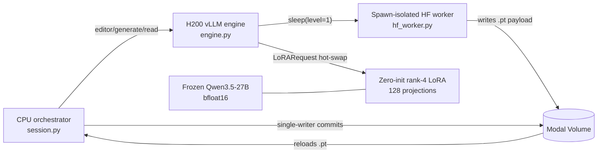

# Self-Rewriting LLMs via Zero-Initialized LoRA Workspaces

[](https://arxiv.org/abs/2611.21885v2)
[](https://github.com/dpss77/lora-self-rewrite/actions/workflows/ci.yml)
[](LICENSE)
[](pyproject.toml)
[](docs/04-operations/COMPUTE_BUDGET.md)

A single-H200 research harness implementing **“Language Models Can Rewrite Their Own
Weights”** ([arXiv:2611.21885v2](https://arxiv.org/abs/2611.21885v2)) with a different edit
surface: the model writes rank-1 direction ablations into a **zero-initialized rank-4 PEFT
LoRA workspace** over the 128 text-backbone output projections of
[Qwen/Qwen3.5-27B](https://huggingface.co/Qwen/Qwen3.5-27B). The frozen base is never rewritten;
adapters are hot-swapped through vLLM.

> **Status: PoC harness complete; compute paused.** The rank-4 LoRA harness, spawn-isolated
> activation reads, exact-batch caches, and held-out evaluator are built and CPU/CI-tested.
> Stage 1 (`math500`) ran the full submit/validation loop and Stage 2 (`DeepScaleR seed0`)
> showed a comparable cutoff geometry on pre-refactor H200 (89.1% vs 80.5% cuts; 0 loops). Stage 1 was statistically null and
> Stage 2 withdrew; a withdrawal is normal in the paper (3/8 submitted, 5/8 withdrew). The
> refactored package still needs its G2 H200 smoke, and no positive efficacy claim exists until
> the multi-seed v1 + 490×8 held-out sweep runs. See [compute budget](docs/04-operations/COMPUTE_BUDGET.md).

## Start here

| I want to… | Read |
| :--- | :--- |
| Understand the project and current state | [`docs/00-START-HERE.md`](docs/00-START-HERE.md) |
| Compute budget / remaining roadmap | [`docs/04-operations/COMPUTE_BUDGET.md`](docs/04-operations/COMPUTE_BUDGET.md) |
| Find the authority for a fact | [`docs/SOURCE-OF-TRUTH.md`](docs/SOURCE-OF-TRUTH.md) |
| Check paper facts vs. v1 choices | [`PAPER_SPEC_2611.21885v2.md`](docs/01-context/PAPER_SPEC_2611.21885v2.md) |
| See what is ready and what is not | [`docs/04-operations/READINESS.md`](docs/04-operations/READINESS.md) |
| Run the CPU verification | [Quickstart](#quickstart-cpu) |
| Understand the architecture | [`docs/02-architecture/MODULE_MAP.md`](docs/02-architecture/MODULE_MAP.md) |
| Read the non-negotiable rules | [`docs/03-protocol/INVARIANTS.md`](docs/03-protocol/INVARIANTS.md) |
| Operate a H200 run | [`docs/04-operations/RUNBOOK.md`](docs/04-operations/RUNBOOK.md) |
| See result records | [`docs/06-experiments/`](docs/06-experiments/) |
| Understand the test strategy | [`tests/README.md`](tests/README.md), [`STD-0005-test-strategy.md`](docs/05-standards/STD-0005-test-strategy.md), [`TEST_MAP.md`](docs/02-architecture/TEST_MAP.md) |
| Contribute or report security issues | [`CONTRIBUTING.md`](CONTRIBUTING.md), [`SECURITY.md`](SECURITY.md) |
| Authors, citations, and AI disclosure | [`AUTHORS.md`](AUTHORS.md), [`CITATION.cff`](CITATION.cff), [`ACKNOWLEDGEMENTS.md`](ACKNOWLEDGEMENTS.md) |
| Release/discoverability metadata | [`docs/04-operations/DISCOVERABILITY.md`](docs/04-operations/DISCOVERABILITY.md), [`CHANGELOG.md`](CHANGELOG.md) |

## Quickstart (CPU)

Requires Python 3.11 and [uv](https://docs.astral.sh/uv/). This project uses **one uv-managed
environment**; do not install project dependencies globally or into another repository’s venv.

```bash
uv sync --frozen --extra cpu --extra dev
uv run pytest -q
./scripts/verify.sh
```

`scripts/verify.sh` runs the three CPU test layers, `ruff check`, `ruff format --check`, and an
in-memory compile. The CPU extra deliberately excludes vLLM, Modal, and the GPU stack.

Dataset and run-record tools:

```bash
uv run python scripts/build_dataset.py --help
uv run python scripts/new_run.py --help
uv run python scripts/summarize_run.py --help
uv run python scripts/finalize_run.py --help
uv run python scripts/check_artifacts.py --help
```

A full dataset build is CPU-only but network-bound and writes under the git-ignored
`datasets/` directory.

## Architecture



The CPU orchestrator owns the turn loop and every Volume write. The vLLM engine serves editor
and generation calls. A spawn-isolated worker extracts activations while vLLM sleeps. All edits
are confined to `lora_A`/`lora_B` on the registered output projections; the base stays frozen.

The edit is an exact rank-1 ablation:

```text
W_eff = W_base - alpha u u^T W_base  <=>  W_base + B[:, k] A[k, :]
B[:, k] = -alpha u        A[k, :] = u^T W_base
```

## What works and what remains

- **Works today:** the harness, protocol/state machine, exact-batch caches, adapter validation,
  resume/preemption handling, held-out gate, run manifests/checksums, and the layered CPU suite.
  S01 ran the full submit/validation loop; S02 showed a comparable cutoff failure mode on
  pre-refactor H200.
- **Pending:** post-refactor G2 H200 smoke, clean multi-seed v1 runs, and the 490 × 8 held-out
  sweep.
- **Not claimed:** that the method improves reasoning. Stage 1 was null; Stage 2 withdrew. The
  paper reports 3/8 submitted and 5/8 withdrew, so a withdrawal alone is not a broken method.

See [`READINESS.md`](docs/04-operations/READINESS.md) for gates and
[`COMPUTE_BUDGET.md`](docs/04-operations/COMPUTE_BUDGET.md) for the remaining cost.

## Running on H200 and compute budget

The H200 path is implemented and ready to run on Modal (paused on the author's account after
`S02-DS-SEED00`). Estimated all-in burn is ~$5.90/H200-hour; a clean seed is roughly 1.1–1.9
hours (~$6.50–$11) once caches are warm. Tier 1 (G2 smoke + multi-seed v1 + 490×8 held-out) is
~$165–$285; see [`COMPUTE_BUDGET.md`](docs/04-operations/COMPUTE_BUDGET.md) for the dated
estimate and assumptions.

The H200 pin, secrets, smoke sequence, seed command, resume rules, and held-out command live in
the [`RUNBOOK`](docs/04-operations/RUNBOOK.md) and the
[`G2 smoke checklist`](docs/04-operations/G2_SMOKE_CHECKLIST.md). Use H200 only; do not add an
H100 fallback.

## Protocol and hardware at a glance

| Item | Value |
| :--- | :--- |
| Hardware | 1× NVIDIA H200 (141 GB) + 128 GiB host RAM; bfloat16 |
| Stack | vLLM 0.34.0, transformers 5.22.2, PEFT 0.22.0, `math-verify==0.9.0` |
| Second Protocol budgets | 20 passes, 200 CPU code runs (≤600 s), 160 turns (hidden), 3.0 h wall, 4,096 tokens/answer |
| Validation | 256 × 2 reserved problems at 4,096 tokens; `SUBMIT`/`WITHDRAW` |
| Held-out | `heldout[500:990]` = 490 problems × 8 samples at 16,384 tokens; one-sided 100k sign-flip, p<0.05 |
| Caching | `enable_prefix_caching=False`; exact-batch base cache; H200-only |
| Scope | 128 text-backbone output projections; `dt_bias`/`A_log` and repair deferred to v2 |

## Three systems findings

1. **Prefix-cache contamination:** on vLLM 0.34.0 + Qwen3.5 + LoRA, enabling prefix caching can
   leak base KV state into later `LoRARequest` generations. The cache is deliberately disabled.
2. **Sleep/spawn activation probing:** vLLM is offloaded with `sleep(level=1)`; HF/PEFT hooks run
   in a spawned child and write `.pt` payloads to the Volume. This avoids parent-process OOMs
   and preserves the single-writer architecture.
3. **Diagnosis geometry:** the DeepScaleR seed showed a comparable failure mode—almost all
   failures are 4,096-token cutoff, not verbatim loops. Our seed: 89.1% cuts, 0/228 loops,
   89.3% accuracy among finished answers. The paper reports 80.5% cutoff, 0 loops, 96% among
   finished; this is a comparable geometry, not an efficacy replication.

## Experiments

| Run | Status | Result |
| :--- | :--- | :--- |
| [`S01-MATH500-R03`](docs/06-experiments/EXP-S01-MATH500-R03.md) | Submitted by the model | Phase-1 `math500` `64×2` sanity validation **null**: +2.3% ± 3.9%, 95% CI [-5.5%, +10.2%], one-sided p=0.347 |
| [`S02-DS-SEED00`](docs/06-experiments/EXP-S02-DS-SEED00.md) | Withdrawn | 89.1% cuts, 0/228 verbatim loops; preempted at 19/20, resumed 20/20, `FINAL_WITHDRAW`; no adapter |

The curated records are the evidence; raw logs and weights stay out of Git.

## Remaining roadmap and compute

| Tier | What it unlocks | Estimate |
| :--- | :--- | ---: |
| **Tier 1 — v1** | G2 smoke, 6–8 clean DeepScaleR seeds, 490×8 held-out for submitted arms | **~$165–$285** |
| **Tier 2 — v1 + v2** | Tier 1 plus `dt_bias`/`A_log`, matching seeds, multi-session chaining | **~$355–$620** |
| **Tier 3 — optional** | Tier 2 plus repair benchmark, extra ablations, larger buffer | **~$440–$765** |

Estimates are planning ranges based on pre-refactor telemetry, not quotes; `metrics.json` is
ground truth. See [`COMPUTE_BUDGET.md`](docs/04-operations/COMPUTE_BUDGET.md) for the breakdown.

## Repository map

| Path | Purpose |
| :--- | :--- |
| `src/lora_self_rewrite/` | protocol, caches, stats, sandbox, LoRA layout, engine/session, held-out evaluator |
| `scripts/` | dataset build, run records, summaries, finalization, checks, verification |
| `configs/experiments/` | experiment configs |
| `tests/` | layered CPU tests; see [`tests/README.md`](tests/README.md) |
| `docs/` | project documentation and experiment records |
| `modal_app.py` | thin Modal entrypoint; protocol logic stays in `src/` |

Module boundaries and the pure/GPU split: [`docs/02-architecture/MODULE_MAP.md`](docs/02-architecture/MODULE_MAP.md).

## Testing & quality

- Layered CPU tests across `unit`, `contract`, and `integration`; `hardware` is excluded by
  default.
- CPU-only test contract: no network, no GPU, no Modal.
- `uv` is the only supported environment manager; CI and `scripts/verify.sh` use the same
  `uv sync`/`uv run` path.
- Cache tags, prompts, grading, loop definitions, adapter validation, and held-out gates are
  contract-tested against golden values.

Details: [`STD-0005-test-strategy.md`](docs/05-standards/STD-0005-test-strategy.md), [`TEST_MAP.md`](docs/02-architecture/TEST_MAP.md).

## Security and limitations

- Secrets come from the environment or a Modal Secret; `.env` is ignored and never committed.
- The model-written sandbox is defence-in-depth, not a security boundary: CPU-only state,
  600 s limit, 10,000-char stdout, AST/attribute denylist, and runtime guards.
- The refactored H200 path is awaiting its post-refactor smoke. On the single
  preempted/resumed `DeepScaleR` seed, rank-1 edits did not replicate and the session
  withdrew; multi-seed Second-Protocol runs are required before concluding on rank-4 LoRA
  versus the paper's 1D `dt_bias` extension.
- No weights, adapters, datasets, raw logs, or secrets are committed.

See [`docs/04-operations/READINESS.md`](docs/04-operations/READINESS.md) and
[`docs/03-protocol/INVARIANTS.md`](docs/03-protocol/INVARIANTS.md). Report vulnerabilities
privately as described in [`SECURITY.md`](SECURITY.md).

## Contributing

See [`CONTRIBUTING.md`](CONTRIBUTING.md) for the environment, test layers, and quality bar.
In short:

- One concern per change; keep diffs scoped.
- Add tests at the lowest layer that can reproduce the behavior; update
  [`TEST_MAP.md`](docs/02-architecture/TEST_MAP.md) for any changed invariant.
- Do not change protocol constants, cache identities, grading/loop definitions, or the
  held-out slice without a decision record and matching tests.
- Hardware tests are explicit, cost-gated, and stay out of CI; project instructions live in
  [`SOURCE-OF-TRUTH.md`](docs/SOURCE-OF-TRUTH.md).

## Citation and license

```bibtex
@misc{lora_self_rewrite_2026,
  title  = {Self-Rewriting LLMs via Zero-Initialized LoRA Workspaces},
  author = {Pardo, Daniel},
  note   = {Implementation and extension of arXiv:2611.21885v2},
  year   = {2026},
  url    = {https://github.com/dpss77/lora-self-rewrite}
}
```

The original paper is *“Language Models Can Rewrite Their Own Weights”*
([arXiv:2611.21885v2](https://arxiv.org/abs/2611.21885v2)). Machine-readable citation metadata
lives in [`CITATION.cff`](CITATION.cff); human authorship and AI assistance are recorded in
[`AUTHORS.md`](AUTHORS.md) and [`ACKNOWLEDGEMENTS.md`](ACKNOWLEDGEMENTS.md). Code is
MIT-licensed ([`LICENSE`](LICENSE)). Base weights and datasets are governed by their respective
upstream licenses.

## Contribute compute or collaborate

- **Run the next seeds:** if you have H200 access or Modal credits, follow the
  [`RUNBOOK`](docs/04-operations/RUNBOOK.md), then share the run manifest, validation/held-out
  artifacts, and an experiment record through a GitHub issue or PR.
- **Sponsor compute:** open a GitHub issue with the tier and amount; no credentials by email. A
  Tier 1 allocation is the smallest useful request.
- **Build v2:** the highest-value extensions are the 1D `dt_bias`/`A_log` wrapper and
  multi-session chaining; start from the paper spec and invariants.

Do not send secrets or private data. Contributions must preserve the protocol gates.

## Short FAQ

**Is this proven to improve reasoning?** No. Held-out has not run; Stage 1 was null and Stage 2
withdrew.

**Does it rewrite base weights?** No. The base stays frozen; edits are LoRA tensors.

**Is this abandoned?** No. The harness is complete and CPU/CI-verified; the remaining blocker is
H200 compute for the multi-seed and held-out sweep.

**Can I run it on one H200?** That is the intended target. The path is implemented but the
refactored package has not had its G2 smoke; H200 runs require a funded budget.

**Why not H100?** Hardware-scoped cache tags prevent bf16 kernel/architecture differences from
confounding paired base-vs-edited statistics. The design also targets H200's 141 GB memory and
bandwidth; an H100 fallback previously produced an unusable cache tag.
